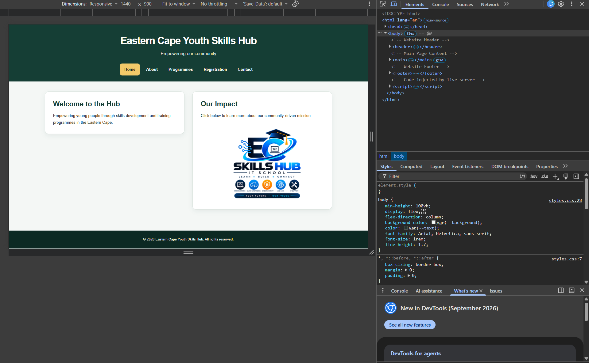
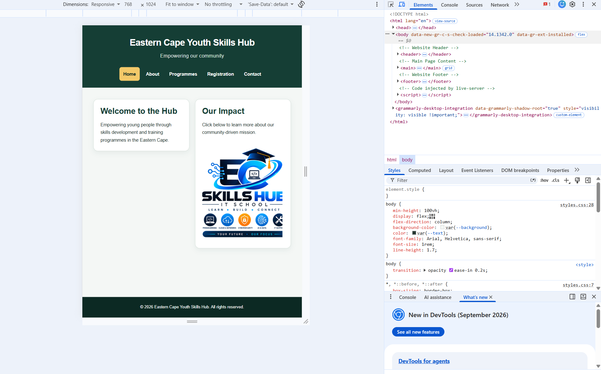
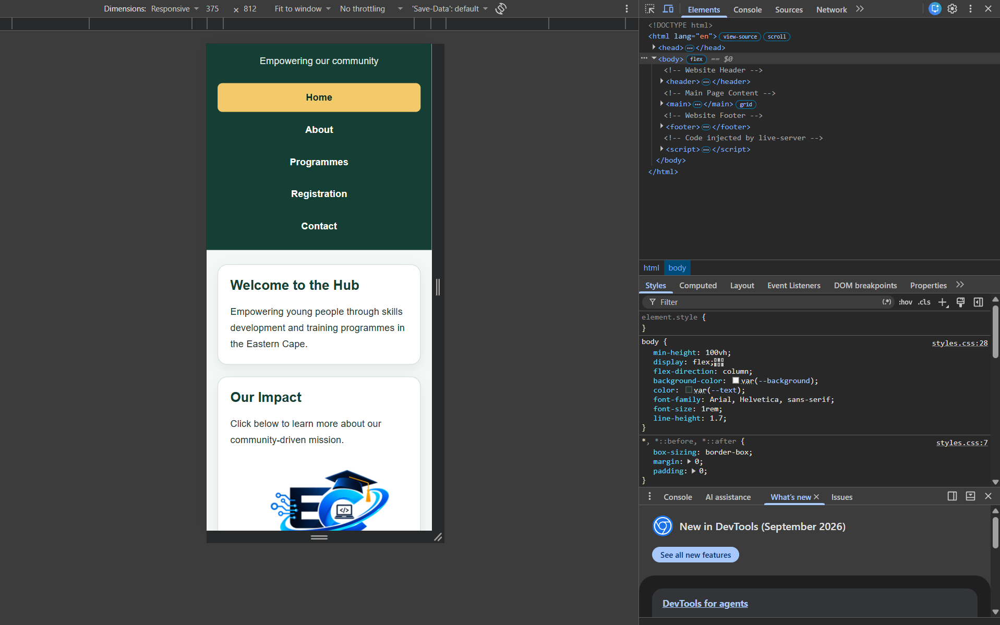
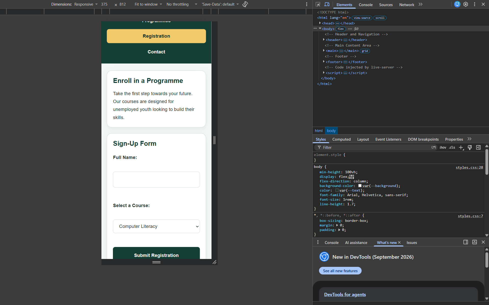
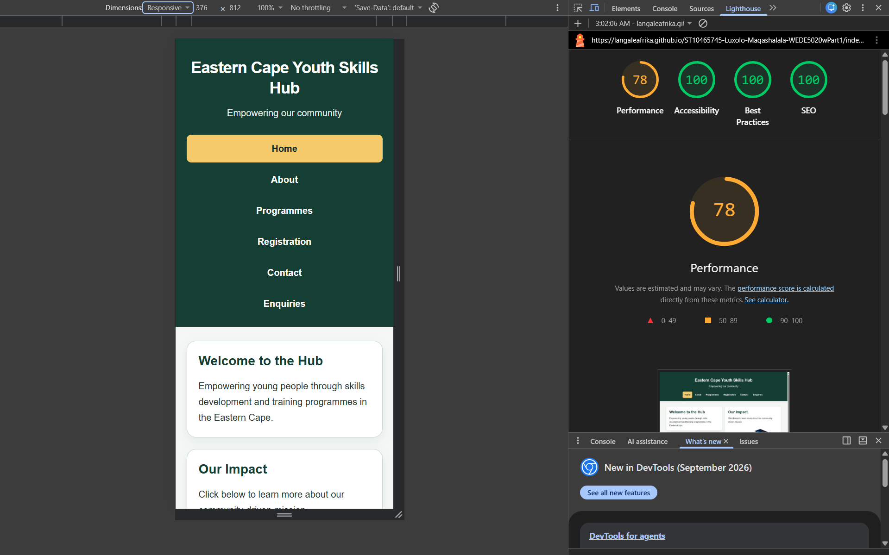
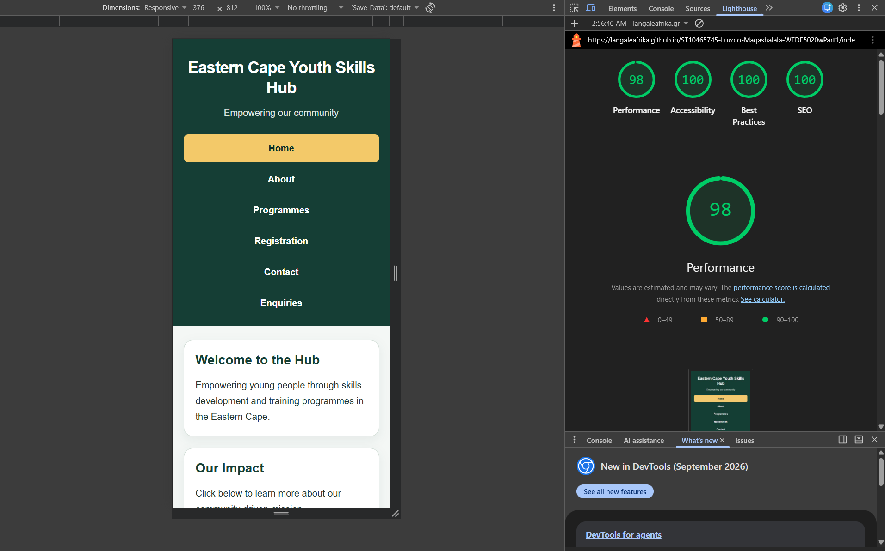

# Eastern Cape Youth Skills Hub — WEDE5020 Portfolio of Evidence

Student Name: Luxolo Maqashalala  
Student Number: ST10465745  
Module: WEDE5020

## Project Overview

This student project develops a website concept for the Eastern Cape
Youth Skills Hub, supporting unemployed youth through computer literacy,
job readiness and entrepreneurship.

Part 1 covers research, planning and the initial HTML structure.
Part 2 introduces CSS styling and responsive design.
Part 3 adds JavaScript interactions, enquiry handling, SEO improvements, 
and public deployment.

The website is an academic prototype. References to the Hub and its
proposed ETC training venue do not establish an operational organisation
or a confirmed partnership.

## Website and Repository

- [Live website](https://langaleafrika.github.io/ST10465745-Luxolo-Maqashalala-WEDE5020wPart1/)
- [Assignment repository](https://github.com/LangaLeAfrika/ST10465745-Luxolo-Maqashalala-WEDE5020wPart1)

## Folder Structure
* /Chosen Proposal: Contains the final rationale (Chosen Proposal.txt) for selecting the Eastern Cape Youth Skills Hub.
* /Proposals: Contains the initial comparison (Proposals guide.txt) between the two candidate organisations (Eastern Cape Youth Skills Hub and Handyman Services).
* /Research: Contains the target audience analysis, user needs, and design strategy (research guide.txt).
* /Website: Contains the foundational HTML structure for the 5-page website prototype, including the images directory.
* /Website: Contains six HTML pages, shared CSS, JavaScript, images,
  sitemap.xml and a project copy of robots.txt.
* /Screenshots: Contains responsive layout and Part 3 testing evidence.
* /.github/workflows: Contains the GitHub Pages deployment workflow.

## Instructions for Viewing

### Online

Open the live website linked above.

### Locally

1. Clone or download the assignment repository.
2. Open the project folder in Visual Studio Code.
3. Open Website/index.html using the Live Server extension.
4. Browse Home, About, Programmes, Registration, Contact and Enquiries.

An internet connection is required for the Leaflet library, map tiles, 
and Formspree submissions. The Contact page's email preparation feature
requires a configured email application or mail handler.

## Part 2: CSS Styling and Responsive Design

Part 2 develops the Eastern Cape Youth Skills Hub prototype through
a shared external stylesheet, consistent navigation, responsive layouts,
and responsive images.

### Styling and Layout

- Linked the website pages to `Website/css/styles.css`.
- Added a CSS reset for consistent spacing and box sizing.
- Defined reusable colours using CSS custom properties.
- Styled headings, paragraphs, navigation, content panels, forms, and footers.
- Used CSS Grid for the main content and Flexbox for navigation.
- Added hover, active, and keyboard-focus styles.
- Used `aria-current="page"` to identify the current navigation link.
- Used relative units, including rem and percentages.

### Responsive Design

The stylesheet includes two main breakpoints:

| Screen width | Behaviour |
|---|---|
| Above 64rem | Desktop layout with two columns where multiple content sections exist |
| Up to 64rem | Reduced heading sizes, spacing, and navigation padding |
| Up to 40rem | Single-column content, stacked navigation, and full-width form buttons |

The Home page logo uses `<picture>`, `srcset`, and `sizes`.
Two resized versions are available at widths of 352 and 704 pixels.
The browser selects an appropriate source according to the displayed
image size and screen pixel density.

## Part 2 Changelog

| Date | Change | Purpose |
|---|---|---|
| 2026-10-28 | Added the shared external stylesheet and page links | Apply consistent styling throughout the website |
| 2026-10-28 | Added typography, colours, borders, shadows, and form styles | Improve readability and visual presentation |
| 2026-10-28 | Standardised page headers and added current-page navigation styling | Improve navigation consistency |
| 2026-10-29 | Moved the logo sizing rule outside the reduced-motion media query | Apply the size limit regardless of motion preferences |
| 2026-10-29 | Added responsive logo markup and resized image sources | Support appropriate image selection on different displays |
| 2026-10-29 | Replaced cropped image copies with proportionally resized versions | Preserve the complete logo |
| 2026-10-29 | Added screenshots for desktop, tablet, and mobile layouts | Document responsive design testing |

These entries describe implementation changes and issues identified
during development. Lecturer feedback from Part 1 should be recorded
separately, with the corresponding correction.

## Responsive Testing Evidence

Testing evidence was captured using Chrome DevTools device emulation.
The dimensions below represent emulated viewport sizes, rather than
tests on physical mobile or tablet devices.

| Page | View | Viewport |
|---|---|---|
| Home | Desktop | 1440 × 900 |
| Home | Tablet | 768 × 1024 |
| Home | Mobile | 375 × 812 |
| Registration | Mobile | 375 × 812 |

### Home: Desktop

### Home: Tablet

### Home: Mobile

### Registration: Mobile

### Issues Investigated

- The logo size rule was initially inside the reduced-motion media query.
  Moving it outside the query allowed it to apply to all users.
- The responsive image copies were initially cropped.
  They were replaced with resized copies that preserve the complete image.
- A CSP warning appeared in the normal Chrome session but did not appear
  during the Incognito check. This suggests a browser-profile or extension
  influence; no CSP weakening was applied.

### Prototype Limitation

The registration form is a front-end prototype. It is not connected to
a database or registration-processing service.
## Part 3: Functionality, SEO and Deployment

### JavaScript Features

- Generated programme cards dynamically using JavaScript.
- Added programme search and alphabetical sorting.
- Displayed result counts and a message when no programmes match.
- Added programme FAQs with accordion behaviour.
- Added an image gallery with a modal lightbox.
- Added an interactive Leaflet map with zoom controls and a marker.
- Added client-side form validation and submission feedback.

The shared JavaScript file is Website/js/scripts.js. Initialisation
functions check for their required page elements before running.

### Forms

#### Enquiries

The enquiry.html page collects a name, email address, enquiry interest
and message.

HTML constraints and JavaScript validation check the input before
submission. Valid enquiries are submitted asynchronously to Formspree
using fetch and FormData.

During submission, controls are disabled to discourage duplicate
requests. Successful submissions display confirmation and guidance
related to the selected interest. Failed or unconfirmed submissions
preserve the entered details.

A successful response confirms acceptance by the submission service;
it does not independently prove delivery to an email inbox.

#### Contact

The contact.html page collects contact details, a message category
and a full message.

After validation, the website prepares an email draft addressed to
st10465745@rcconnect.edu.za. The visitor reviews and sends the draft
through their email application. Preparing the draft does not
automatically send the email.

#### Registration Limitation

The registration page remains a front-end prototype. It does not
create an account, reserve a programme place or store registrations
in a database.

### Interactive Map

The Contact page uses Leaflet and OpenStreetMap tiles to show an
approximate location for Eastcape Training Centre (ETC), Spondo Street,
Struandale, Gqeberha.

The venue is labelled as a proposed location for this student project.
The map includes a marker popup, zoom controls and a separate Google
Maps link. OpenStreetMap attribution remains visible.

### Search Engine Optimisation

- Added unique page titles and meta descriptions.
- Reviewed heading hierarchy and descriptive image alternative text.
- Added contextual internal links.
- Used descriptive page filenames and consistent navigation.
- Retained responsive layouts and responsive logo image sources.
- Published an XML sitemap listing the six website pages.

Target phrases were selected from the project's audience, location
and programme content, including:

- Eastern Cape youth skills
- Skills development in Gqeberha
- Computer literacy
- Job readiness
- Entrepreneurship training

These are project-relevant keyword choices, not claims of measured
search volume or ranking performance.

### Sitemap and robots.txt

The sitemap is available at:

https://langaleafrika.github.io/ST10465745-Luxolo-Maqashalala-WEDE5020wPart1/sitemap.xml

A project copy of robots.txt is stored in Website/robots.txt.

Because this GitHub Pages project is hosted under a repository path,
the effective robots.txt file is published at the host root through
the separate LangaLeAfrika.github.io repository:

https://langaleafrika.github.io/robots.txt

The root file allows crawling and references the assignment sitemap.
A sitemap and robots.txt do not guarantee search-engine indexing.

### Off-Page SEO Plan

Potential promotion includes sharing the project through appropriate
student or professional social profiles and requesting relevant links
from willing community or training partners.

Any public promotion should clearly identify the website as a student
project. No completed backlink campaign or confirmed external partnership
is claimed in this documentation.

### Performance Measures

- Used resized logo sources with picture, srcset, and sizes.
- Used shared external stylesheets and JavaScript.
- Loaded page scripts with defer.
- Used lazy loading for gallery thumbnails.
- Loaded the Leaflet library on the Contact page.

### Lighthouse Results

The live homepage was audited using Chrome DevTools Lighthouse.

| Audit date | Report | Performance | Accessibility | Best Practices | SEO |
|---|---|---:|---:|---:|---:|
| 2026-11-03 | Desktop | 78 | 100 | 100 | 100 |
| 2026-11-03 | Mobile | 98 | 100 | 100 | 100 |

These are individual laboratory audit results, not measurements from
real visitors. Scores can vary between runs.

The desktop performance audit scored 78. Lighthouse flagged image
delivery for EC_logo-medium.png (approximately 297 KiB) and cache
lifetimes. Further image compression remains a future improvement.
The mobile performance audit scored 98.

Automated accessibility, best-practice, and SEO scores do not replace
manual testing or constitute a complete security assessment.

#### Desktop Audit

#### Mobile Audit

### Security and Data Handling

- The deployed website uses HTTPS.
- Formspree submissions use an HTTPS endpoint.
- Client-side validation improves input feedback but is not a substitute
  for server-side validation.
- Programme cards use DOM creation and textContent for text content.
- External links opened in a new tab use appropriate rel attributes.
- No unsafe-eval exception was added to resolve the earlier browser warning.
- Enquiry details are processed by Formspree, as explained beside the form.

The public Formspree form endpoint is not a private API credential.
Visitors should not submit sensitive information through this prototype.

### Deployment

GitHub Pages publishes the contents of the Website using:

.github/workflows/deploy-pages.yml

The workflow runs on pushes to master and can also be triggered manually.
It uploads the Website folder and deploys it to the GitHub Pages
environment.

The separate root-host repository serves robots.txt. The assignment
source code remains in the original assignment repository.

### Testing Evidence

The developer reported testing the forms and saving screenshot evidence.
The following evidence records specific views and outcomes; screenshots
alone do not prove that every interaction or error case passed.

| Evidence | File |
|---|---|
| Programme page | Screenshots/programmes-desktop.png |
| AJAX enquiry confirmation | Screenshots/enquiry-ajax-success.png |
| Interactive map | Screenshots/contact-map.png |
| Published sitemap | Screenshots/sitemap-live.png |
| Root robots.txt | Screenshots/robots-live.png |
| Desktop Lighthouse audit | Screenshots/lighthouse-home-desktop.png |
| Mobile Lighthouse audit | Screenshots/lighthouse-home-mobile.png |

### Part 2 Feedback

No Part 2 lecturer feedback has been supplied for this documentation.
When feedback becomes available, record each comment, its correction, 
and the relevant date or commit.

### Part 3 Changelog

| Period | Change | Purpose |
|---|---|---|
| November 2026 | Added dynamic programme cards, search and sorting | Help visitors find relevant programmes |
| November 2026 | Added FAQs and gallery lightbox | Improve interaction and content exploration |
| November 2026 | Added enquiry validation and contextual responses | Guide visitors through programme enquiries |
| November 2026 | Added contact email preparation | Let visitors review and send a compiled message |
| November 2026 | Connected enquiries to Formspree using AJAX | Submit enquiries without a full page reload |
| November 2026 | Added the ETC location map | Demonstrate interactive location functionality |
| November 2026 | Updated titles, descriptions and internal links | Improve page descriptions and navigation |
| November 2026 | Configured GitHub Pages deployment | Publish the website online |
| November 2026 | Added sitemap.xml and robots.txt | Document page URLs and crawler instructions |
| November 2026 | Moved SEO files out of an accidentally nested Website folder | Correct their published paths |
| November 2026 | Published robots.txt at the host root | Make crawler rules available at the required location |
| 2026-11-03 | Recorded Lighthouse audit results | Document measured homepage quality and outstanding performance work |

## References

Formspree (n.d.) *Formspree documentation*.
Available at: https://help.formspree.io/
(Accessed: October 2026).

GitHub (n.d.) *Using custom workflows with GitHub Pages*.
Available at: https://docs.github.com/en/pages/getting-started-with-github-pages/using-custom-workflows-with-github-pages
(Accessed: November 2026).

Google (n.d.) *Introduction to Lighthouse*.
Available at: https://developer.chrome.com/docs/lighthouse/overview
(Accessed: October 2026).

Google (n.d.) *Create and submit a robots.txt file*.
Available at: https://developers.google.com/crawling/docs/robots-txt/create-robots-txt
(Accessed: 3 November 2026).

Leaflet (n.d.) *Leaflet documentation*.
Available at: https://leafletjs.com/reference-1.9.4.html
(Accessed: November 2026).

OpenStreetMap contributors (n.d.) *Copyright and licence*.
Available at: https://www.openstreetmap.org/copyright
(Accessed: October 2026).

Eastcape Training Centre (n.d.) *Contact us*.
Available at: https://www.etc.org.za/contact-us/
(Accessed: November 2026).
## Image Credits

The Eastern Cape Youth Skills Hub logo (`EC_logo.png`) was generated
using OpenAI’s ChatGPT for this student project.

The files `EC_logo-small.png` and `EC_logo-medium.png` were resized
from the original AI-generated image for responsive display.
